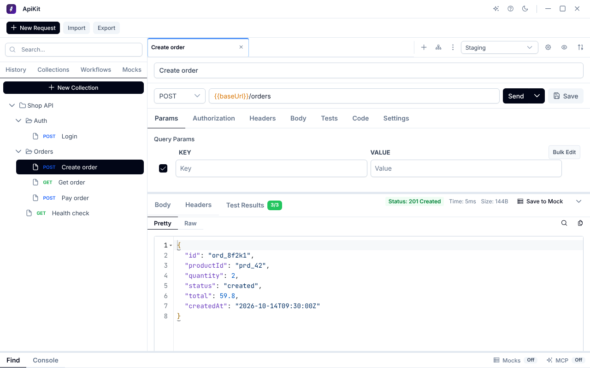

# ApiKit

<div align="center">

一个现代化、轻量级的 API 测试工具


[下载](#下载安装) • [功能特性](#功能特性) • [文档](https://duwei0227.github.io/apikit/) • [更新日志](CHANGELOG.md)

[English](README.en.md) | 中文

</div>


## 简介

ApiKit 是一个跨平台的 API 测试工具，专为开发者设计，提供简洁直观的界面和强大的功能。无论是日常接口调试还是自动化测试，ApiKit 都能满足你的需求。

### 为什么选择 ApiKit？

- 🚀 **快速启动** - 轻量级设计，秒速启动，低内存占用
- 💻 **跨平台** - 支持 Windows、macOS 和 Linux
- 🎨 **现代界面** - 简洁美观，支持深色 / 浅色主题切换
- 🔗 **工作流编排** - 串联多个请求，支持条件分支与循环
- 📦 **便携版本** - 提供免安装版本，解压即用
- 🔄 **自动更新** - 应用内一键更新，无需重新下载
- 🆓 **完全免费** - 开源软件，永久免费使用

## 功能特性



| 功能 | 说明 | 文档 |
|------|------|------|
| 🌐 HTTP 请求 | 常用方法和请求体类型（JSON 请求体可写注释，发送时去掉；JSON / XML 发送前校验格式，Beautify 自动补全）、Bearer / Basic 鉴权、文件上传下载、生成和导入 cURL | [发送请求](https://duwei0227.github.io/apikit/guide/requests) |
| 🧪 测试与断言 | 状态码和 JSON 字段断言（期望值可用变量），从响应 JSON 或响应头提取变量 | [测试与断言](https://duwei0227.github.io/apikit/guide/tests) |
| 📡 流式响应 | SSE 和逐行 JSON 边收边显示，自动合并大模型的回答、思考内容和 token 用量 | [响应](https://duwei0227.github.io/apikit/guide/responses) |
| 🌍 变量 | 环境变量、全局变量和 `$guid`、`$randomInt`、`$sequence` 等内置动态变量，输入 `{{` 时自动补全 | [变量](https://duwei0227.github.io/apikit/guide/variables) |
| 📁 集合 | 多层文件夹，拖拽或右键菜单排序；导入 Postman、OpenAPI / Swagger 和 cURL，导出 ApiKit JSON 或 Postman | [集合](https://duwei0227.github.io/apikit/guide/collections)、[导入导出](https://duwei0227.github.io/apikit/guide/import-export) |
| 🔗 工作流 | 文件夹分类，拖动或右键菜单排序、移动；串联请求，条件分支和循环（多个条件、先后满足）、循环间隔、`$loopIndex`、Set Variables，运行日志逐步查看 | [工作流](https://duwei0227.github.io/apikit/guide/workflow) |
| 🧩 Mock 服务 | 在本机端口模拟接口，按规则返回不同响应，响应模板可读取请求、批量生成列表 | [Mock 服务](https://duwei0227.github.io/apikit/guide/mock) |
| 🤖 AI 集成（MCP） | AI 工具通过 MCP 读取和修改集合、请求、工作流和环境，发送请求和删除前由你确认 | [AI 集成](https://duwei0227.github.io/apikit/guide/ai) |
| 📝 Console 和历史 | 查看每次实际发出的请求和响应，从历史重新打开请求 | [Console 和历史](https://duwei0227.github.io/apikit/guide/console-history) |

快捷键、数据存储位置和常见问题见[参考](https://duwei0227.github.io/apikit/guide/reference)。

## 下载安装

访问 [Releases](https://github.com/duwei0227/apikit/releases/latest) 页面下载最新版本。

### Windows

| 安装包类型 | 说明 | 推荐 |
|----------|------|------|
| `.msi` | Windows 安装程序 | ⭐ 推荐 |
| `.exe` | NSIS 安装程序 | |
| `.zip` | 便携版（解压即用） | 适合 U 盘使用 |

### macOS

| 安装包类型 | 说明 | 推荐 |
|----------|------|------|
| `.dmg` | macOS 磁盘映像 | ⭐ 推荐 |

**系统要求**: macOS 11 Big Sur 或更高版本，且 Safari 已更新到 16.4 或更高（界面使用系统的 WebKit 显示）。

**注意**: macOS 用户首次打开可能需要在"系统偏好设置 → 安全性与隐私"中允许运行。

### Linux

| 安装包类型 | 说明 | 推荐 |
|----------|------|------|
| `.AppImage` | 便携版（无需安装） | ⭐ 推荐 |
| `.deb` | Debian/Ubuntu 安装包 | |
| `.rpm` | Fedora/RHEL/CentOS 安装包 | |
| `.tar.gz` | 便携版（解压即用） | |

**系统要求**: `.deb`、`.rpm` 和便携版使用系统的 WebKitGTK 显示界面，建议保持系统更新（WebKitGTK 2.50 或更高）；较旧的版本中粗体文字可能显示为常规粗细。AppImage 自带 WebKitGTK，不受系统版本影响。

**AppImage 使用方法**:
```bash
chmod +x ApiKit_*.AppImage
./ApiKit_*.AppImage
```

**便携版使用方法**:
```bash
tar -xzf ApiKit_*.tar.gz
cd ApiKit
./install-desktop.sh  # 可选：创建桌面快捷方式
./apikit.sh
```

## 文档

完整的使用说明见文档站：**https://duwei0227.github.io/apikit/** ，应用中也可以从 **Help → Documentation** 打开。

- [快速开始](https://duwei0227.github.io/apikit/guide/getting-started)：发送第一个请求、保存到集合、使用环境变量
- [工作流示例](https://duwei0227.github.io/apikit/guide/workflow#示例)：登录取 token、轮询异步任务、分页
- [连接 AI 工具](https://duwei0227.github.io/apikit/guide/ai#连接)

## 反馈与支持

### 问题反馈

如果遇到问题或有功能建议，请访问：
- [GitHub Issues](https://github.com/duwei0227/apikit/issues) - 报告 Bug
- [GitHub Discussions](https://github.com/duwei0227/apikit/discussions) - 功能建议和讨论

### 贡献代码

欢迎提交 Pull Request！请查看 [贡献指南](CONTRIBUTING.md)（如有）。

## 许可证

本项目采用 [MIT 许可证](LICENSE)。

## 相关链接

- [GitHub 仓库](https://github.com/duwei0227/apikit)
- [发布页面](https://github.com/duwei0227/apikit/releases)
- [更新日志](CHANGELOG.md)

## 致谢

ApiKit 的开发离不开以下优秀的开源项目：

- [Tauri](https://tauri.app/) - 跨平台桌面应用框架
- [Vue.js](https://vuejs.org/) - 渐进式 JavaScript 框架
- [PrimeVue](https://primevue.org/) - Vue UI 组件库
- [Ace](https://ace.c9.io/) - 代码编辑器组件
- [Vite](https://vitejs.dev/) - 下一代前端构建工具

---

<div align="center">

**如果觉得 ApiKit 有用，请给个 ⭐ Star 支持一下！**

Made with ❤️ by [@duwei0227](https://github.com/duwei0227)

</div>
